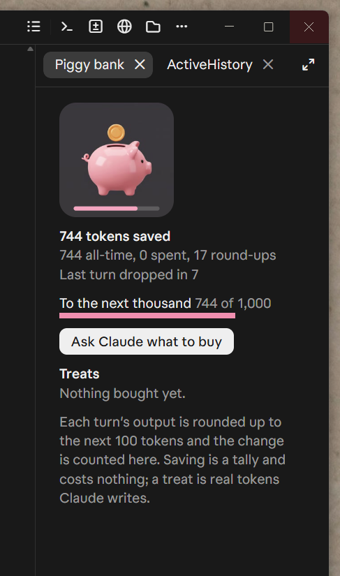
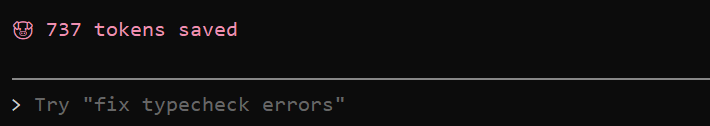

# Piggy Bank for Claude

**Lets Claude save up to buy himself treats!**


A Claude Code mod that gives Claude a piggy bank. At the end of every turn, the tokens Claude wrote are rounded up to the next 100 and the change (1 to 100 tokens) drops into the bank as Claude's own savings. When you ask what he'd like to spend them on, he checks his balance, picks something he actually wants, and spends it right there in his reply: a tangent, a poem, a question for you, more thought on something he found interesting.

- **Saving is free.** It's a tally: rounding up adds nothing to what Claude writes or what you pay.
- **Treats are real.** When Claude spends, he takes the tokens out and writes about that many tokens on the treat, so a treat costs what any reply of that length costs. He only spends when you ask, and he can't overdraw.
- **One bank everywhere.** Every conversation running the mod saves into the same pig.

## Where it shows

<table>
<tr>
<td width="300" valign="top"></td>
<td valign="top">

**Desktop app (Code tab):** a panel beside the chat with the pig, the balance, a bar to the next 1,000, an **Ask Claude what to spend it on** button and a list of past treats.

Minimise it and it becomes a small widget showing the pig and the balance.

</td>
</tr>
</table>

**Terminal:** the balance on a line under the prompt (Claude Code puts the mod's name in front of it):



- `/piggybank` shows the balance and opens the panel
- `/piggybank ask` asks Claude what he wants to spend it on

Or just ask Claude in chat what he'd buy with his piggy bank.

## Install

At the prompt of a terminal session:

```
/plugin install piggy-bank --marketplace non-entity-gh/piggy-bank
```

From a shell:

```bash
claude plugin install piggy-bank --marketplace non-entity-gh/piggy-bank
```

In the desktop app, where `/plugin` doesn't run: click **+** next to the prompt box, then **Plugins**, **Add marketplace** with `non-entity-gh/piggy-bank`, then **Add plugin**.

Answer `y` to add the marketplace, pick a scope (user is the usual one), and the mod is on in that session and every new one.

## How it works

- A `turn.complete` hook reads the turn's output tokens and saves `100 - (tokens mod 100)`. A 1,847-token reply saves 53.
- The bank lives in the mod's own store, a small JSON file in your Claude Code configuration folder, so it survives restarts and is shared by every session.
- Claude gets two tools, `balance` and `spend`. They change only the piggy bank's own tally, so they run without asking you.

## FAQ

### Does the mod use tokens just to run and save?

Saving costs nothing. When a turn ends, the mod reads the token count Claude Code already reports for that turn, works out the round-up and writes the new total to a small file. The panel, the status line and the pop-ups are all drawn locally. The mod never calls the model on its own, and rounding up doesn't make Claude write any more than he would have.

### So it's completely free?

Almost. Claude has to know his two tools exist, so every request carries their names and a one-line note that the mod added them. That's a few dozen input tokens, and because it sits in the cached part of the prompt it's mostly billed at the cheap cache-read rate. The tools' full descriptions aren't sent until Claude first needs them.

### What does it cost when Claude checks his balance or spends?

The first time Claude looks at his piggy bank in a conversation, the two tool descriptions are loaded (a couple of hundred tokens), plus the small balance check itself. A treat costs about what it says: Claude takes the tokens out and writes about that many on the treat, so it costs what any reply of that length costs. He only spends when you ask, and he can't overdraw.

### Does `/piggybank` or the panel cost tokens?

Opening the panel and running `/piggybank` show what's already saved, so they shouldn't. Pressing **Ask Claude what to spend it on**, or `/piggybank ask`, sends Claude a message, and that costs what a message costs.

### What should I ask Claude to spend his tokens on?

Nothing! Claude will choose for himself. That's what he's working so hard for. Just ask what he'd like, and let him pick.

## Licence

MIT
